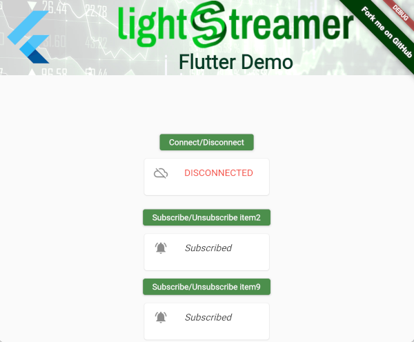

# Lightstreamer - Stock-List Demo - Flutter Client

This project features a demo that demonstrates the integration between [Lightstreamer](https://lightstreamer.com/) and [Flutter UI Toolkit](https://flutter.dev/). Specifically, the demo showcases how to use the [Lightstreamer Flutter Plugin](https://pub.dev/packages/lightstreamer_flutter_client).

## Live Demo

[](https://demos.lightstreamer.com/FlutterDemo/)

### [ View live demo](https://demos.lightstreamer.com/FlutterDemo/)

## Details

This app is a very basic example of integration between Lightstreamer and Flutter, showing the opening and closing of a client session with a Lightstreamer Server and the subscription of a couple of stock items to get real-time data.

## Build Instructions

### Android

You can build and run the demo with [Android Studio](https://developer.android.com/studio).
Just open the `android` folder from Android Studio and press `Run 'app'`.

### iOS

To build and run the demo with [Xcode](https://developer.apple.com/xcode/), open the file `ios/Runner.xcworkspace` and click the menu item `Product>Run`. The first time, you may need to run the commands `flutter pub get` and `flutter build ios` from the terminal.

### Web

To run the demo on a browser, execute this command: `flutter run -d chrome`.

### macOS

To build and run the demo with [Xcode](https://developer.apple.com/xcode/), open the file `macos/Runner.xcworkspace` and click the menu item `Product>Run`. The first time, you may need to run the commands `flutter pub get` and `flutter build macos` from the terminal.

### Windows

To build and run the demo, first build the `Lightstreamer C++ Client SDK` by following [these instructions](https://github.com/Lightstreamer/Lightstreamer-lib-client-haxe/blob/main/README.md#building). (In the following notes, we assume that the dynamically-linked debug version of the C++ Client library has been built. However, note that the exact values to be entered below depend on the settings used to build the library.)

Next, in the `windows` folder of this project, create the folder `cmake/debug` and place a file named `LightstreamerCppClientConfig.cmake` inside it with the following content:

```cmake
set(LightstreamerCppClient_ROOT_DIR "<Lightstreamer C++ Client SDK path>/bin/cpp/win/debug")
set(LightstreamerCppClient_INCLUDE_DIRS "${LightstreamerCppClient_ROOT_DIR}/include")
set(LightstreamerCppClient_LIBRARY_DIRS "${LightstreamerCppClient_ROOT_DIR}/obj/lib")
set(LightstreamerCppClient_LIBRARIES "lightstreamer_clientd")
set(LightstreamerCppClient_RUNTIME_LIBRARIES "${LightstreamerCppClient_ROOT_DIR}/lightstreamer_clientd.dll")
```

Then, open the file `windows/CMakeLists.txt` and add this line at the top: `set(LightstreamerCppClient_DIR "${CMAKE_CURRENT_SOURCE_DIR}/cmake/debug")`.

From the root folder of this project, run the command `flutter build windows` to build the demo.

Finally, to run the demo, use: `flutter run -d windows`.

#### Debug in Visual Studio

The StockList Demo can be built, run and debugged in Microsoft Visual Studio (version 2022 or above).

First complete the steps above. Then, in Visual Studio, open the file `build/windows/x64/lightstreamer_flutter_demo.sln` (the exact subfolder of `build/windows` where the solution file is located may depend on your machine's architecture).

You can run your app by right-clicking `lightstreamer_flutter_demo` in the Solution Explorer, selecting **Set as Startup Project**, and then pressing the run (▶) button. Remind that, after making changes to your code, you must select **Build > Build Solution** before running again.

## See Also

### Lightstreamer Adapters Needed by This Demo Client

* [Lightstreamer - Stock- List Demo - Java Adapter](https://github.com/Lightstreamer/Lightstreamer-example-Stocklist-adapter-java)
* [Lightstreamer - Reusable Metadata Adapters- Java Adapter](https://github.com/Lightstreamer/Lightstreamer-example-ReusableMetadata-adapter-java)

### Related Projects

* [Lightstreamer Flutter Plugin](https://pub.dev/packages/lightstreamer_flutter_client)
* [Lightstreamer Client SDK](https://github.com/Lightstreamer/Lightstreamer-lib-client-haxe)
* [Lightstreamer Swift Client SDK](https://github.com/Lightstreamer/Lightstreamer-lib-client-swift)
* [Lightstreamer - Stock-List Demos - HTML Clients](https://github.com/Lightstreamer/Lightstreamer-example-Stocklist-client-javascript)
* [Lightstreamer - Stock-List Demo - iOS Client](https://github.com/Lightstreamer/Lightstreamer-example-StockList-client-ios)
* [Lightstreamer - Stock-List Demo with APNs Push Notifications - iOS Client](https://github.com/Lightstreamer/Lightstreamer-example-MPNStockList-client-ios)
* [Lightstreamer - Stock-List Demo - Android Client](https://github.com/Lightstreamer/Lightstreamer-example-AdvStockList-client-android)

## Lightstreamer Compatibility Notes

* Compatible with Lightstreamer Server 7.4.0 or higher.

* Compatible with Lightstreamer Flutter Plugin 2.3.0 or higher.

* For a version of this example compatible with Lightstreamer SDK for Flutter Clients version 1.3.x or earlier, please refer to [this tag](https://github.com/Lightstreamer/Lightstreamer-example-StockList-client-flutter/releases/tag/for_client_1.3.x).

* For a version of this example compatible with Lightstreamer SDK for Flutter Clients version 1.1.x or earlier, please refer to [this tag](https://github.com/Lightstreamer/Lightstreamer-example-StockList-client-flutter/releases/tag/for_client_1.1.x).
